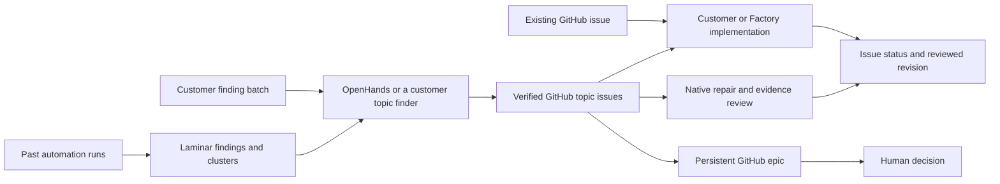
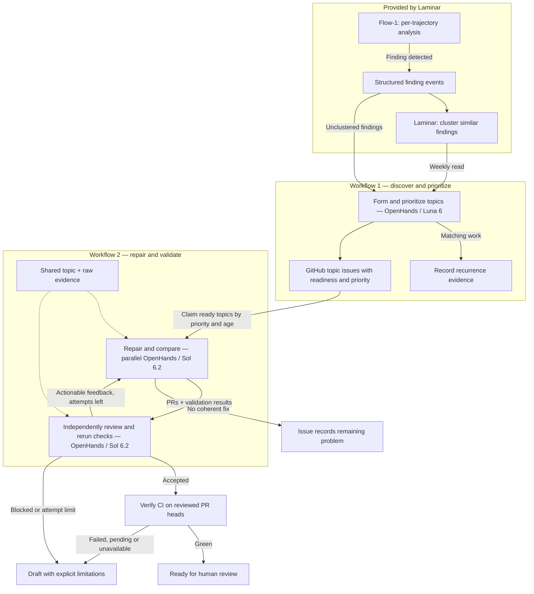

# How the self-improving automation works

**Turn observed automation failures into proposed code improvements—with evidence
for a human merge decision.**

- Flow-1 or a customer collector provides observations. Discovery turns them into GitHub investigation briefs.
- Fixes can target customer configuration or any relevant authorized repository.
- Before/after evidence and independent review determine readiness. Unproven fixes
  stay draft; humans merge and deploy.

## Two workflows

1. **Discover and prioritize** — `triage_workflow.py` reads findings, updates the
   topic issues and the persistent GitHub epic, and records recurrence evidence.
2. **Repair and validate** — `repair_workflow.py` queries and claims eligible GitHub
   topic issues, then runs repairs and independent reviews. It refreshes the epic
   after recording outcomes, including newly tracked cross-repository issues.

The combined native schedule runs both entrypoints under one worker lock and inference budget. Its report retains both discovery and repair results. The discovery, native repair and Factory handoff entrypoints can also be packaged as separate disabled imports. A shared persistent dispatcher coordinates writers for each issue scope.

For a debugging question about one automation, run `collect_signals.py` from the discovery package. It reads existing Laminar results for a chosen time window and saves a private inventory. You can inspect it locally or pass it to discovery for ranking. During publication, discovery keeps the newest observed Signal run for each trace and compatible definition in the worker’s private `signal-history.sqlite3`. Include this file when moving worker state. It prevents an older capture from requeuing a finding after a later run replaced or cleared it. [Worked example and supported filters](README.md#inspect-laminar-findings-for-one-automation)

### How the stages fit a repository’s Software Factory

The Software Factory is the team’s complete set of repository automations. A collector can file the issue, another automation can triage it, and the team can select its existing implementer and reviewer. The issue connects those stages and records which one owns the next action.

| Starting point | Handoff and owner |
| --- | --- |
| Laminar Signal | Discovery groups evidence and publishes an investigation brief. Native repair can load the indexed evidence and build the comparison cohort. Set `execution_owner=external` to send new topics to an external workflow. |
| Another collector | Supply an `openhands.findings.v1` batch with stable occurrence IDs, times and observations. The ranker can read evidence scoped to a batch record. Discovery publishes externally owned investigations. |
| Another topic finder | An operator-installed program can group and prioritize findings from either source. It returns proposals against the supplied evidence references and schema. The workflow validates the plan and handles GitHub publication and recurrence. |
| An existing GitHub issue | A trusted maintainer enrolls the issue after deciding it is ready to implement. The customer adapter or configured Factory route can use its existing brief. |
| Customer implementation or review | Claim one attempt and report the outcome, reviewed Git revisions, limitations and next actor. The receiving worker reconciles head changes on GitHub. |
| Factory implementation | Assignment triggers the Canvas resolver, or a configured Linear ticket triggers the implementation poller. A distinct reviewer receives an explicit request once the configured checks pass. The bridge reflects its current observations on the original issue. |

GitHub carries the public brief, original priority rationale, recurrence links, current lifecycle labels and outcome. Private worker storage carries raw findings, source attribution, claim receipts and validation artifacts. See [installation and queries](README.md) and [Factory handoff and recovery](FACTORY_HANDOFF.md).

## From findings to PRs

**Provided by Laminar:** [Signals](https://laminar.sh/docs/signals/introduction)
use Flow-1 to analyze each selected trajectory (trace) and produce structured
finding events when a problem matches the configured instruction. Laminar then
automatically [clusters similar events](https://laminar.sh/docs/signals/clusters)
asynchronously. Our deployment stores traces and findings in self-hosted Laminar
and routes Flow-1 inference to Laminar Cloud. We configure and consume these
capabilities; this repository does not implement the analyzer or clustering.

**Dotted arrows show evidence access.** Both repair and review agents can inspect
the topic/issue, original traces and Signals, source, frozen inputs and execution
logs. The separate reviewer checks the repair's claims and can execute focused
tests or replays as needed.

| Step | Work performed | Output |
| --- | --- | --- |
| **Laminar: analyze** | Flow-1 inspects each trace selected by the Signal's trigger, filters and coverage setting. | Structured findings with trace evidence |
| **Laminar: cluster** | Laminar groups similar finding events asynchronously within each Signal. | Recurring-pattern clusters |
| **1. Prepare** | Python reads events and available clusters, tracks the backlog and creates compact counts/examples. Unclustered events and ambiguous origins remain visible. | Evidence indexed by a weekly issue |
| **2. Prioritize** | Luna merges duplicate mechanisms, ranks topics P0–P3 and comments with new evidence on existing issues/PRs. Matching backlog issues keep their readiness and human priority. | GitHub topic backlog |
| **3. Repair and compare** | Sol diagnoses each topic, chooses repositories, implements, tests and opens or revises linked draft PRs. Later attempts receive the review feedback. | Candidate fixes and before/after evidence |
| **4. Review** | A separate Sol agent checks topic claims against raw evidence, exact revisions, execution records and CI; reruns focused checks where useful. | Ready or draft PRs |

**Clusters are not final repair topics.** Luna may merge or split Laminar groups
to identify one underlying problem spanning automations or repositories. One
topic can require several PRs. Reviewers can request another repair with actionable
feedback, followed by a fresh review. **`max_repair_attempts=2`** allows the initial
attempt plus one revision. The same repair conversation receives a short message
with the completed review and feedback, retaining its history and tools and
allowing prompt-cache reuse. Each review uses a separate conversation. Acceptance,
external blockers, the attempt limit or resource limits stop the loop. The same
frozen comparison inputs are retained.

**GitHub is the backlog.** Native-owned topic issues with one priority, the ready label and accessible private evidence remain eligible across runs. Repair claims the oldest issues at the highest
priority first, subject to the topic limit. Open repair PRs, active claims and
blocked issues prevent dispatch. The worker lock and dispatch ledger coordinate
claims and recovery. A completed or inconclusive attempt requires an explicit
ready label to be considered again.

**Choose the right repair layer.** Agents can improve prompts, skills/plugins,
tools/MCP configuration, hooks, agent/LLM profiles, context settings, automation
code, SDK integration or dependencies. Any authorized repository is in scope by
default; customer-only repairs are optional. Configuration changes need a real
application path and before/after settings, including effects on other users of shared
profiles. GitHub permissions must match the configured scope.

## What makes a fix convincing?

- Compare fixed inputs: up to **N finding-linked negative conversations** and
  **N randomly sampled completed conversations without findings**, default **N=5**.
  No-finding does not mean healthy; missing data stays explicit.
- Each PR's **Before / After Evidence** states observed changes, tested counts,
  versions and limitations. Full replays, captured-input projections and synthetic
  checks are identified separately.
- Passing code tests alone does not prove better agent behavior. Remaining target
  failures, new control regressions or insufficient evidence can keep a PR draft.

## Main controls

| Setting | Default / meaning |
| --- | --- |
| Schedule | Weekly, Monday 08:00 UTC |
| Flow-1 coverage | Separate Laminar setting: sample or all matching traces |
| `max_topics_per_run` | 10 eligible topics per run, regardless of the number of PRs |
| `max_repair_attempts` | 2 total repair attempts per topic, including the initial attempt |
| `repair_concurrency` | Defaults to the topic limit |
| `validation_sample_size` | 5 inputs per comparison group when available |
| Agent profiles | Configurable; built-in defaults are Luna 6 / Sol 6.2 / Sol 6.2 |
| `repair_scope` | `any_authorized` (default): any relevant authorized destination; `customer_stack`: home + configured repositories only |
| Resource guards | Configurable cost, duration and conversation limits; parallel spend is not strictly capped globally |

## Issues, privacy and test runs

**Issues are living briefs.** Agents explain the problem, example, prevention and
current evidence before the data references. They rewrite their current-run brief
as conclusions change and archive prior versions privately. Triage refreshes the indexed evidence on matching topic issues and comments on
matching issues/PRs. Repair starts from the selected topic issue. Bounded repair
revisions update the same current brief and PRs.

**Raw evidence stays private.** Issues publish opaque references that an authorized worker can resolve to inputs, Signals, prompts and logs. Public explanations use sanitized summaries; credential
checks supplement agent privacy review. Public upstream work must not name or
link private customer repositories; authorized readers retrieve the full evidence
through a private index.

**QC can start fresh.** `isolated_validation=true` with fresh state selects topic issues within that validation run’s namespace.
Repair still runs native agents and can create actual draft PRs.

For setup and operational details, see the [runbook](README.md),
[example configuration](weekly.example.json) and
[weekly orchestrator](tarball/weekly.py).
