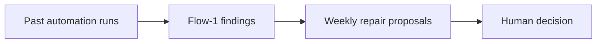
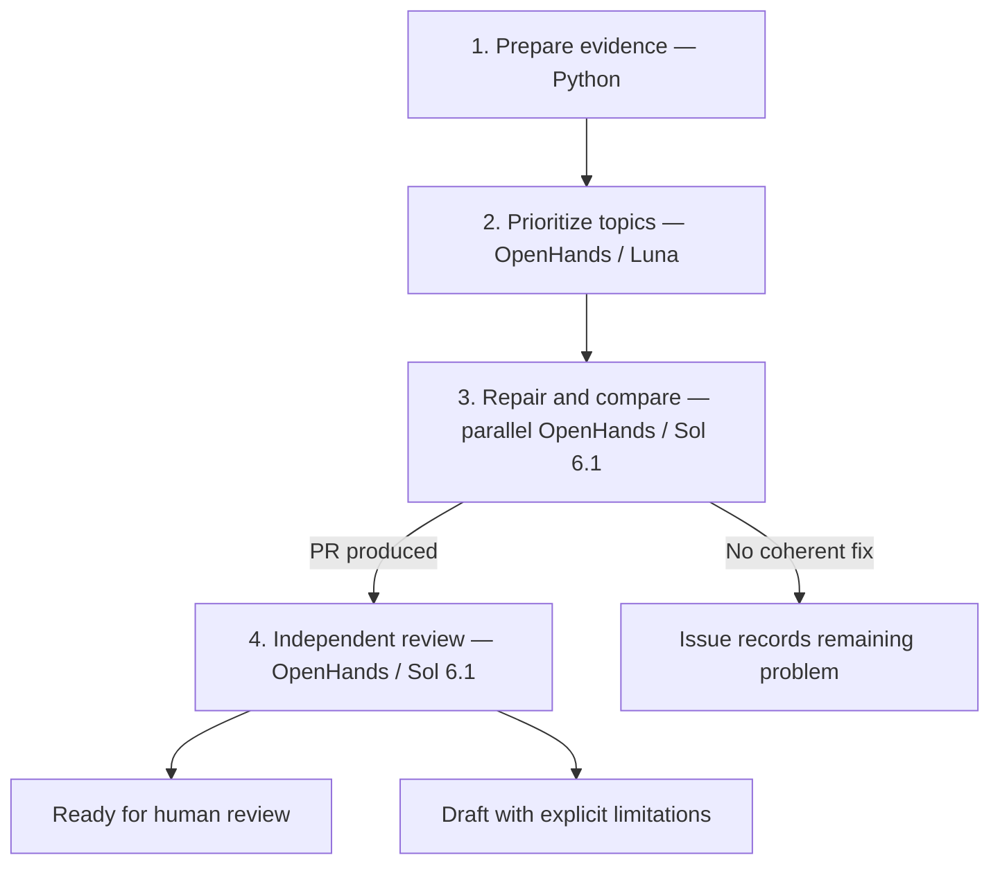

# How the self-improving automation works

**Turn observed automation failures into proposed code improvements—with evidence
for a human merge decision.**

- Flow-1 finds potential problems; OpenHands agents investigate and propose fixes.
- Fixes can target automations, reusable extensions or the SDK, across repositories.
- Before/after evidence and independent review determine readiness. Unproven fixes
  stay draft; humans merge and deploy.

## From findings to PRs

**Upstream:** instrumentation sends traces to self-hosted Laminar. A configured
Signal automatically runs Flow-1 on a sample or all matching finished traces.
The LLM profile routes inference to Laminar Cloud; findings remain in self-hosted
Laminar. The weekly automation reads these saved findings without rerunning Flow-1.

| Step | Work performed | Output |
| --- | --- | --- |
| **1. Prepare** | Python collects Signals, tracks the backlog and creates compact counts/examples. Ambiguous origins remain visible. | Evidence indexed by a weekly issue |
| **2. Prioritize** | Luna merges duplicate mechanisms, separates unrelated problems, considers existing work and ranks topics P0–P3. Clusters are leads, not proven causes. | Prioritized topic queue |
| **3. Repair and compare** | One Sol agent per selected topic diagnoses, chooses repositories, implements, tests and opens linked draft PRs with before/after results. | Candidate fixes and evidence |
| **4. Review** | A separate Sol agent checks exact revisions, changes, execution records and CI, then records a verdict. | Ready or draft PRs |

A topic may span automations and require several PRs. Agents use normal OpenHands
tools and source/data access. Python handles collection and bookkeeping. Each
selected topic gets one best repair attempt; produced PRs receive independent
review. There is no automatic repair-until-green loop or replacement-topic quota.

## What makes a fix convincing?

- Compare fixed inputs: up to **N finding-linked negative conversations** and
  **N randomly sampled completed conversations without findings**, default **N=5**.
  No-finding does not mean healthy; missing data stays explicit.
- Each PR's **Before / After Evidence** states observed changes, tested counts,
  versions and limitations. Full replays, captured-input projections and synthetic
  checks are identified separately.
- Passing code tests alone does not prove better agent behavior. Remaining target
  failures, new control regressions or insufficient evidence can keep a PR draft.

## Main controls

| Setting | Default / meaning |
| --- | --- |
| Schedule | Weekly, Monday 08:00 UTC |
| Flow-1 coverage | Separate Laminar setting: sample or all matching traces |
| `max_topics_per_run` | 10 topic attempts; counts topics, not PRs |
| `repair_concurrency` | Defaults to the topic limit |
| `validation_sample_size` | 5 inputs per comparison group when available |
| Agent profiles | Configurable; built-in defaults are Luna / Sol 6.1 / Sol 6.1 |
| Resource guards | Configurable cost, duration and conversation limits; parallel spend is not strictly capped globally |

## Issues, privacy and test runs

**Issues are living briefs.** Agents explain the problem, example, prevention and
current evidence before the data references. They rewrite their current-run brief
as conclusions change and archive prior versions privately. Production reuses a
matching issue through a new brief comment; existing descriptions remain intact.

**Raw evidence stays private.** Issues link to authorized access for inputs,
Signals, prompts and logs. Public explanations use sanitized summaries; credential
checks supplement agent privacy review.

**QC can start fresh.** `isolated_validation=true` with fresh state excludes earlier
prototype outputs. It still runs repair agents and creates actual draft PRs.

For setup and operational details, see the [runbook](README.md),
[example configuration](weekly.example.json) and
[weekly orchestrator](tarball/weekly.py).
